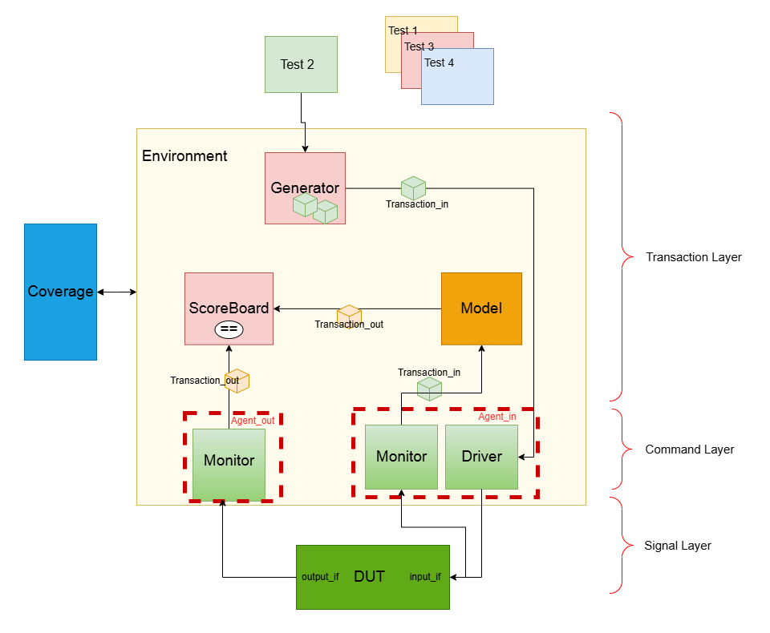

# Coverage-driven verification of a multi-cycle ALU

The project contains supplied multi-cycle RTL and a class-based verification environment. Supplied RTL/framework headers credit Alireza Abbasian; verification extensions and the accompanying technical report are by Reza Sanaee Nezhad. Preserve the supplied MIT license and source attribution when redistributing this package.

See `RUNNING.md` for test selection and reproduction. The design defaults to eight-bit input beats, 32-bit operands, 16-bit result beats and 64-bit complete results. Software reset is opcode 111; physical reset is active low.

